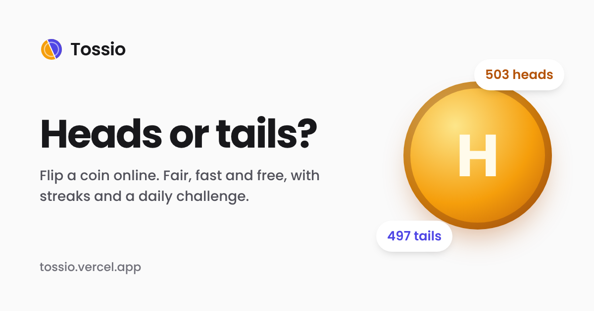

# Tossio

A free online coin flip. Heads or tails in one tap, plus a few extras for the curious.

Try it at **[tossio.vercel.app](https://tossio.vercel.app)**



## About

Sometimes you just need a coin and you don't have one in your pocket. Tossio is a quick, fair one
that works on any phone or computer. It's free, there are no ads and you don't need an account.

Around the coin there's some extra fun: a daily challenge, a prediction game, a decision maker,
and a simulator that flips a million coins at once, along with short guides to the maths and
physics of coin tosses.

## Features

- **Flip a coin.** A 3D coin with sound, your flip history, running totals and streaks. Tap the
  coin or press Space.
- **Decision flip.** Type two options and let the coin choose.
- **Daily challenge.** The same goal for everyone each day, plus a prediction game: call heads
  or tails before you flip and build a streak.
- **Simulator.** Flip from 100 to 1,000,000 coins in one go and see how close you get to 50/50.
  There's also a deliberately unfair "weighted coin" to experiment with, and your last 100 runs
  are saved.
- **Design your coin.** Change the finish, the symbols and the labels.
- **Statistics and achievements.** Totals, longest streaks, your best simulations and 14
  achievements.
- **Guides.** Coin flip probability (with a live demo of the law of large numbers and a table of
  streak odds) and how coin flipping works, from real coins to random numbers.
- **Works offline** once it has loaded, and can be added to your home screen.
- **Light and dark mode.**

### How fair is it?

Each flip uses the browser's cryptographic random number generator (`crypto.getRandomValues`),
so heads and tails are exactly 50/50 and every flip is independent of the ones before. The
animation is just for show: the result is decided the moment you flip.

Everything you do is stored in your browser's `localStorage`. Nothing is sent to a server.

## Run it locally

You need [Node.js](https://nodejs.org/) 18 or newer (20+ recommended).

```bash
git clone https://github.com/shoaibmarif/tossio.git
cd tossio
npm install
npm run dev
```

Then open <http://localhost:5173>.

### Scripts

| Command | What it does |
| --- | --- |
| `npm run dev` | Start the development server with hot reload |
| `npm run build` | Type-check and build the production site into `dist/` |
| `npm run preview` | Serve the production build locally |
| `npm test` | Run the tests (Vitest) |

The production build also writes a separate HTML file for every page, each with its own title,
description and social-preview tags, plus `sitemap.xml`, `robots.txt` and `404.html`.

## Project structure

```text
src/
  pages/            One component per page
  components/       Coin, controls, stats, tools, layout and UI pieces
  context/          App state: flips, streaks, experiments, achievements, settings
  game/             Randomness, streaks, statistics, experiments, daily challenges, sounds
  data/             FAQ content
  seo/              Site config, per-page SEO metadata and structured data
  storage/          localStorage persistence
  __tests__/        Unit tests and a render test for every page
scripts/seoPlugin.ts  Build step that writes per-page HTML and the sitemap
vercel.json           Hosting config: page routing, redirects, caching headers
```

Good places to start:

- **Name, domain and links:** `src/seo/site.ts`
- **Page titles and descriptions:** `src/seo/routes.ts`
- **Randomness:** `src/game/random.ts`
- **Daily challenges and achievements:** `src/game/challenges.ts`

## Tech stack

React 19, TypeScript, Vite, Tailwind CSS, React Router and Vitest. Hosted on Vercel.

## Deploying

Import the repository into Vercel; it reads the build settings from `vercel.json`. If you deploy
somewhere else or use a different domain, update `url` in `src/seo/site.ts`.

## Contributing

Bug reports and ideas are welcome. Please
[open an issue](https://github.com/shoaibmarif/tossio/issues) first for anything big, and run
`npm test` and `npm run build` before sending a pull request.

## Author

Made by **Shoaib Arif**

- Portfolio: [shoaibarif.vercel.app](https://shoaibarif.vercel.app/)
- LinkedIn: [linkedin.com/in/shoaibmarif](https://www.linkedin.com/in/shoaibmarif/)
- GitHub: [@shoaibmarif](https://github.com/shoaibmarif)
- Email: [shoaibmuhammadarif@gmail.com](mailto:shoaibmuhammadarif@gmail.com)
